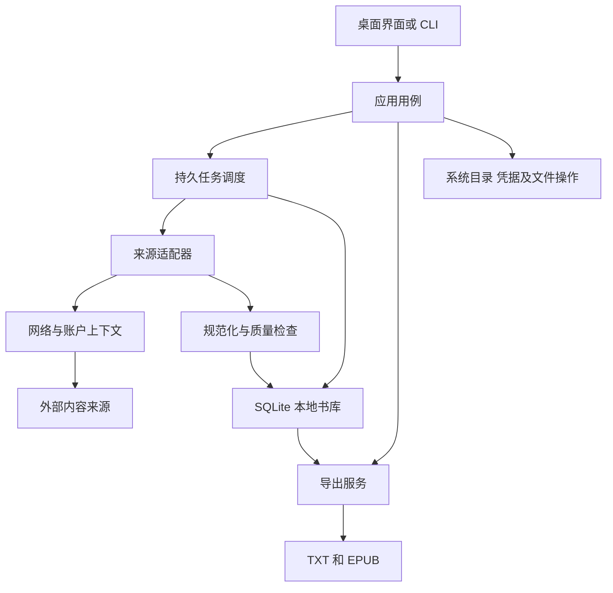

# OpenNovel Downloader 项目完整计划书

Technical Research and Full Project Development Plan

| 项目 | 内容 |
| --- | --- |
| 项目名称 | OpenNovel Downloader |
| 文档版本 | 1.2 |
| 编制日期 | 2026-10-14 |
| 当前阶段 | 已进入开发；实现与验收状态以 task.md 和 docs/verification 为准 |
| 面向读者 | 项目所有者、开发者、测试人员及后续开源贡献者 |
| 文档用途 | 统一产品范围、架构、来源适配策略、实施顺序及验收要求 |
| 首发目标 | Windows x64 桌面应用，提供真实来源的小说获取、恢复与 TXT/EPUB 导出 |
| 核心方向 | 独立实现的多平台小说下载引擎，配套本地书库与统一操作界面 |
| 开发前置条件 | 正式代码开发前先初始化 Git，提交规划及仓库基础配置，再创建业务代码 |

本项目以 Fanqie-novel-Downloader 的功能与解决问题的方法为参考，独立设计并实现可扩展的多平台小说下载软件。项目主线是逐步建立真实、可验证的来源获取能力，同时保证下载中断可恢复、缺章情况可见、已保存内容可长期管理和重新导出。

第一版先完成真实免费小说平台的可用闭环，再用第二个不同来源检验架构；本地 JSON 仅用于工程验证，不能代替平台接入。起点、晋江等付费平台纳入后续升级计划，按免费内容、账户内容、已订阅内容以及其他复杂获取场景分阶段研究。未购买 VIP 章节的可获取性目前未验证，不作为首版或稳定版的必达承诺。

本文是正式开发的执行依据，不是已完成开发或平台支持的证明。2026-10-14 的规划基线已先于业务代码提交；2026-10-20 已进入免费平台适配。工程基础、实验性来源接入和第一版验收是三个不同阶段。

## 目录

1. [项目背景与规划依据](#s01)
2. [产品定位与成功标准](#s02)
3. [范围与版本边界](#s03)
4. [用户场景与功能需求](#s04)
5. [小说来源适配计划](#s05)
6. [账户与 VIP 场景研究计划](#s06)
7. [技术选型与决策条件](#s07)
8. [总体架构与模块职责](#s08)
9. [数据模型与存储设计](#s09)
10. [任务状态与核心流程](#s10)
11. [内容质量与文件导出](#s11)
12. [桌面交互与信息架构](#s12)
13. [隐私与安全设计](#s13)
14. [非功能要求与性能预算](#s14)
15. [测试策略与验收矩阵](#s15)
16. [开发阶段与工作分解](#s16)
17. [资源与时间估算](#s17)
18. [Git 初始化与开发纪律](#s18)
19. [持续集成与发布流程](#s19)
20. [开源维护与治理](#s20)
21. [风险登记与应对](#s21)
22. [决策记录与范围变更](#s22)
23. [正式开发启动清单](#s23)
24. [研究来源与证据边界](#s24)

## 1 项目背景与规划依据

### 1.1 用户已经明确的要求

- 以参考项目为蓝本学习功能与实现方法，开发属于 OpenNovel 的独立项目。
- 不复制参考项目代码，不直接照搬其架构。
- 面向多个小说平台，优先考虑番茄、七猫、书旗，并规划起点和晋江。
- 研究 VIP 场景；如果复杂付费内容暂时无法实现，保留在后续升级路线。
- 最初先完成计划书；此后已授权初始化 Git 和业务开发，2026-10-21 要求继续完成剩余阶段。
- 正式开发前必须先初始化 Git，然后再开始代码开发。
- 不自动推送远程仓库；重要版本的 tag 另行确认。

规划基线先于业务代码提交。当前以 [剩余阶段执行清单](docs/REMAINING_PHASES.md) 逐项推进，已实现范围和证据以 task.md、docs/sources.md 与验证记录为准。

### 1.2 参考项目研究结论

2026-10-13 的研究区分了两个版本：

| 版本 | 固定提交 | 可以作为依据的内容 |
| --- | --- | --- |
| 当时的公开主分支 | `9fa8f45eb28f13a7aea1af1df21b3367a5317a2c` | 项目文档、发布工作流、更新元数据和产物审计 |
| 转为发布外壳之前的历史应用 | `5a8f8752b46379db24fb85b4baa3713ddab90aeb` | Python 下载核心、Web/CLI 调用链、JSON 保存、导出与平台适配 |

当前参考项目的公开说明将 Rust/Tauri 核心放在私有仓库。本项目未取得该私有实现，不以“已完整阅读当前应用源码”为前提。历史版展示的主要是外部 API 节点客户端，没有完整展示这些节点如何取得番茄正文。[R1][R2][R3]

值得吸收的方法包括：目录与章节 ID 对齐、任务与界面分离、并发和速率分别控制、缺章补齐、统一导出，以及按平台和安装形态分发产物。

需要改进的历史问题包括：状态和正文分开保存、使用临时目录承载恢复数据、部分路径的完整率判定过宽、取消信号未贯穿执行链、章节范围与缓存混用，以及业务核心依赖界面层状态。以上均是对固定历史源码的分析，不代表当前私有版本存在相同问题。[R3][R4]

### 1.3 证据状态约定

全文采用四类状态：

| 状态 | 含义 |
| --- | --- |
| 用户已确定 | 来源于本会话的明确要求 |
| 规划基线 | 本计划采用的实施方案，允许在技术验证后通过决策记录调整 |
| 研究待验证 | 没有完成接口、账号、正文或安装环境实测 |
| 未来候选 | 暂不进入当前版本验收范围 |

商业来源按具体能力分别验收。番茄、七猫和晋江部分官网公开正文已实现，书旗当前仅详情/目录；账户、已购权限和其他系统安装仍待相应实测。任何支持声明必须附验证日期、适配器版本、场景和限制。

## 2 产品定位与成功标准

### 2.1 产品定位

OpenNovel Downloader 是以多平台内容获取为主线的开源桌面软件。它将来源识别、作品信息、章节获取、下载恢复、书库管理和电子书导出组织为统一流程。

用户不应为每个平台学习一套下载工具。开发者也不应为每增加一个平台就修改通用调度器或导出器。

### 2.2 目标用户

| 用户 | 主要需求 | 初期覆盖方式 |
| --- | --- | --- |
| 普通小说读者 | 输入链接即可保存，失败后能继续 | 简单桌面流程、明确错误与重试入口 |
| 电子阅读器用户 | 正确的 TXT/EPUB、目录和顺序 | 标准导出、阅读器兼容性验收 |
| 多平台阅读用户 | 同一界面管理不同来源 | 平台适配器与能力矩阵 |
| 有订阅账户的用户 | 正确识别自己可访问的章节 | 分阶段加入账户与已订阅场景 |
| 高级用户与贡献者 | CLI、可测试接口和清晰扩展方式 | 共享核心、来源契约与开发文档 |

### 2.3 核心竞争力

1. 获取范围和完整性透明：能解释什么已保存、什么缺失、什么受限。
2. 下载可靠：已提交章节不因任务中断丢失，失败恢复不必重新获取整本。
3. 来源可扩展：平台变化被限制在适配层，失效来源可以单独停用。
4. 内容本地可用：来源失效后，已有书库仍能管理、预览和导出。
5. 开源可维护：源码、构建方法、验证范围与已知限制公开。

### 2.4 成功标准

- v0.1 至少完成一个真实来源从链接到本地文件的完整流程。
- v0.2 用第二个不同来源证明通用核心可复用。
- 稳定版不能把只拿到详情或目录宣传为支持全本下载。
- 下载 80/100 章时必须显示部分完成，不通过缩小分母显示 100%。
- 来源不可用不影响已保存内容的本地操作。
- 新贡献者能够按照文档在受支持环境构建并运行测试。
- 起点、晋江及复杂 VIP 研究结果以能力清单呈现；未完成不阻塞其他来源发布。

## 3 范围与版本边界

### 3.1 版本定义

| 版本或阶段 | 产品目标 | 主要范围 |
| --- | --- | --- |
| 开发准备 | 建立可回退的工程起点 | Git 初始化、规划基线、基础约束 |
| 技术预研 | 验证真实来源及关键技术 | 番茄路径、第二来源候选、存储恢复、桌面运行 |
| v0.1 | 单平台可用桌面版 | 真实来源、链接输入、选章、恢复、TXT/EPUB、Windows 安装 |
| v0.2 | 多平台版 | 第二来源、统一能力展示、来源隔离、可用时的站内搜索 |
| v0.3 | 账户支持版 | 会话管理、账户隔离、权限识别、登录失效处理 |
| v0.4 实验分支 | 付费来源实验 | 起点或晋江一个经验证的范围；不承诺全部 VIP |
| v1.0 稳定分支 | 长期可维护版本 | 已验收来源、增量更新、备份恢复、迁移与稳定发布 |
| 后续版本 | 扩展功能 | 更多来源、复杂付费场景、阅读器、其他桌面平台及移动端 |

v0.4 是实验分支标识，不是 v1.0 的强制依赖。若付费来源研究未通过，稳定分支可基于 v0.3 和已验证来源继续完成 v1.0；实验分支不得污染稳定支持清单。

### 3.2 v0.1 必须完成

2026-10-20 范围确认：用户选择“官网实际开放内容，缺章明确标注；App 正文后续扩展”。v0.1 的首来源因此限定为番茄官网公开网页，账户、App 专属正文和未购 VIP 不作为本版必达项。所选集合完成与整本完整分开呈现。这项确认不豁免本节功能要求和第 15 节的安装等发布验收。

- Windows x64 可安装、可启动版本。
- 一个经验证的真实来源；优先番茄，具体支持范围由预研决定。
- 粘贴链接或输入明确书籍 ID，取得详情和目录。
- 全部可获取章节或指定范围下载。
- 持久任务、暂停、取消、恢复及失败章节重试。
- 章节保存与完成标记共同提交。
- 缺章、受限章节和异常正文的明确展示。
- 基础书库列表、书名/作者检索和正文预览。
- TXT 与 EPUB 导出，以及导出文件位置与结果记录。
- 清晰的来源状态和脱敏错误信息。

如果首个真实来源未通过准入，只能交付标注为“内部引擎验证版”的受控样例程序，不能用它冒充 v0.1 商业平台支持。

### 3.3 初期暂缓

不在 v0.1 中实现全平台聚合搜索、五平台同时适配、移动端、云同步、自动购买章节、动态插件市场、PDF/漫画/有声书、完整沉浸阅读器、推荐系统或自研运行时代码热更新。

本地 TXT/EPUB 导入是 v0.2 以后的实用候选，也可用于内部测试；它不替代真实在线来源的验收。

### 3.4 平台支持边界

Windows x64 是首发验收平台。架构保留 macOS/Linux 可移植性，但只有完成原生安装、运行、恢复与文件操作验收后才对外标注支持。移动端需要独立处理后台任务、文件授权及发布渠道，不承诺与桌面同时交付。

## 4 用户场景与功能需求

### 4.1 关键用户场景

场景 A：用户复制作品链接，软件识别平台，显示详情、目录和可获取范围。用户选择下载，关闭后重新打开仍能继续，完成后导出 EPUB。

场景 B：用户下载一部长篇小说，部分章节遇到临时网络失败。软件保存成功章节，列出缺失原因，之后只重试失败项。

场景 C：用户检查连载更新，软件取得新目录，识别新增、改名、重排和已知修订。失败更新不覆盖旧的可用正文。

场景 D：用户连接付费平台账户，软件显示章节访问状态。登录过期时暂停相关任务；不会自动购买未订阅章节，也不会把登录页保存成正文。

场景 E：某来源暂时失效，用户仍可管理本地作品、预览章节及生成其他格式文件。

### 4.2 功能需求清单

| 编号 | 功能 | 验收要求 | 目标版本 |
| --- | --- | --- | --- |
| FR-01 | 链接与 ID 识别 | 正确匹配来源；不支持的链接说明原因 | v0.1 |
| FR-02 | 作品详情 | 标明来源、作者、简介和获取时间；未知字段不伪造 | v0.1 |
| FR-03 | 目录与选章 | 分卷、顺序、范围与离散选择准确 | v0.1 |
| FR-04 | 创建下载任务 | 防重复提交，返回持久任务 ID | v0.1 |
| FR-05 | 暂停与继续 | 停止新调度，已提交内容保留，可恢复 | v0.1 |
| FR-06 | 取消 | 执行链响应取消；取消后旧结果不能覆盖状态 | v0.1 |
| FR-07 | 重启恢复 | 已保存正文不丢失，未完成项可恢复 | v0.1 |
| FR-08 | 失败重试 | 区分可重试与需人工处理，仅重试目标项 | v0.1 |
| FR-09 | 完整性展示 | 同时展示选章完成度和目录覆盖度 | v0.1 |
| FR-10 | 本地书库 | 列表、检索、基础预览和内容状态 | v0.1 |
| FR-11 | TXT 导出 | 编码、顺序、段落正确；避免静默覆盖 | v0.1 |
| FR-12 | EPUB 导出 | 标准结构、目录、资源与阅读顺序正确 | v0.1 |
| FR-13 | 多来源 | 第二来源不要求重写调度和导出 | v0.2 |
| FR-14 | 站内搜索 | 能力允许时提供；搜索结果保留来源身份 | v0.2 |
| FR-15 | 小批量任务 | 有队列上限、去重、逐项结果和限流 | v0.2 |
| FR-16 | 标签与归档 | 用户标签独立于远端元数据 | v0.2 |
| FR-17 | 账户管理 | 按平台及账户隔离，会话可退出与失效 | v0.3 |
| FR-18 | 章节权限 | 免费、已订阅、需购买、锁定、未知分别展示 | v0.3 |
| FR-19 | 付费来源实验 | 按已验收能力开放，不以平台名笼统承诺 | v0.4 实验 |
| FR-20 | 增量更新 | 比较目录身份与修订，保留旧版本 | v1.0 |
| FR-21 | 备份恢复 | 一致性备份；在干净数据目录验证恢复 | v1.0 |
| FR-22 | 数据迁移 | 版本记录、迁移前备份及失败恢复 | v1.0 |
| FR-23 | 诊断导出 | 用户预览后导出脱敏信息，不含正文与凭据 | v1.0 |
| FR-24 | 更新检查 | 精确匹配平台和安装形态；初期可手动更新 | v1.0 |

### 4.3 删除与清理

明确区分“移出书架”“删除离线正文”“删除导出文件”“删除全部本地作品数据”。删除前显示影响范围；删除正文前检查是否存在相关运行任务。平台下架不自动删除本地内容。

## 5 小说来源适配计划

### 5.1 来源研究优先级

| 来源 | 初始研究内容 | 后续扩展 | 当前证据状态 |
| --- | --- | --- | --- |
| 番茄 | 链接、详情、目录、正文路径及外部依赖 | 搜索、更新、批量与必要的账户场景 | 待实测；历史参考客户端不能证明现有正文路径 |
| 七猫 | 作品结构、目录、可获取正文及限制 | 登录、更新和更多作品类型 | 待实测 |
| 书旗 | 作品结构、目录、可获取正文及限制 | 登录、更新和更多作品类型 | 待实测 |
| 晋江 | 目录、免费章节、VIP 标记及账户差异 | 已订阅内容和复杂章节状态 | 待实测；不承诺完整 VIP |
| 起点 | 目录、免费章节、VIP 标记及账户差异 | 已订阅内容和复杂章节状态 | 待实测；不承诺完整 VIP |
| 其他 | 接口、页面结构、使用条件及维护成本 | 按需求增加 | 逐项筛选 |

番茄优先验证。第二来源从七猫和书旗中按真实结果选择。起点和晋江可以较早摸底，但完整适配安排在账户能力之后。

### 5.2 能力矩阵

每个来源分别声明：链接识别、搜索、详情、目录、免费正文、登录正文、已订阅正文、批量获取、增量更新和账户退出。每项状态为未研究、实验、稳定、受限、暂时失效或不支持。

能力记录包含适配器版本、应用兼容范围、最近验证时间、验证场景、已知限制和维护者。显示“稳定”必须有对应验收记录；网页可打开或目录可读取不等于正文可下载。

### 5.3 接入策略

优先研究平台提供并允许使用的接口、导出渠道以及可获取页面。用户文件导入是补充路线。第三方 API 提供方必须明确标注，不能仅因注释写着“官方”就认定为官方接口。

来源 Source 表示作品所属平台；提供方 Provider 表示数据获取渠道。默认不在不同提供方之间静默切换正文版本。允许切换时必须确认作品、章节 ID、目录与正文质量可对齐，并记录渠道变化。

### 5.4 适配器契约

适配器最小职责是解析输入、获取详情、取得目录和取得单章内容。搜索、认证、批量和更新提示按能力可选实现。

适配器输出标准领域数据，不直接写数据库，不控制 GUI，不自行生成 EPUB。网络请求使用核心提供的访问上下文，以便统一执行超时、速率、取消、日志脱敏和账户隔离。

返回错误必须区分：输入无效、来源不支持、需登录、需购买、访问受限、内容下架、限流、网络失败、响应结构变化和内容不完整。保留服务端原始错误类别的脱敏摘要，不把所有失败转换为一个布尔值。

### 5.5 来源准入与退出

稳定准入要求：真实样本验证、完整目录规则、稳定章节身份、正确正文、错误分类、请求预算、限流处理、契约测试和支持范围说明全部具备。

初步验证建议覆盖短篇、长篇、连载、完结、分卷、下架或失效链接。付费来源另覆盖登录过期、已订阅和未订阅状态。平台不存在的场景可标注不适用并说明依据，不能伪造测试通过。

适配器出现结构变化时，先降级为实验或失效，保留本地书库；问题定位后修复并重新验收。远程状态提示只提供信息，初期不下载并执行未审查的适配器代码。

## 6 账户与 VIP 场景研究计划

### 6.1 研究分层

| 编号 | 研究范围 | 进入开发条件 | 发布定位 |
| --- | --- | --- | --- |
| VIP-01 | 目录与 VIP 标记识别 | 可稳定识别章节身份及访问提示 | 可进入基础支持 |
| VIP-02 | 登录后免费内容 | 会话建立与失效机制明确 | 账户版本 |
| VIP-03 | 用户已购买或订阅内容 | 真实账户场景、内容完整性和导出条件经过核实 | 按平台标注支持范围 |
| VIP-04 | 会员、限免或时效权益 | 能正确判断当前权益及变化 | 后续增强 |
| VIP-05 | 特殊客户端或内容格式 | 取得合法测试条件，明确协议与格式限制 | 实验适配 |
| VIP-06 | 未购买 VIP 章节可获取性，即用户提出的破解方向 | 当前无可行性结论；需明确具体机制、来源和适用条件 | 未来研究，不进入必达交付承诺 |

“有 VIP 的平台”可以先支持元数据、目录与免费章节。账户拥有阅读权限、工具取得完整正文、工具可以导出，是三个需要分别核实的问题。[R10][R11]

### 6.2 技术研究问题

对每个平台确认：限制发生在展示、会话、服务端权限还是特殊内容格式；当前账户实际收到的是完整正文、预览、错误页还是拒绝；章节内容是否存在分段与版本差异；订阅状态是否可可靠识别。

如果服务端根本不向当前账户返回正文，本地格式转换不能生成缺失的原文。第三方接口声称能返回全文也不证明渠道稳定、来源可信或取得相应授权。不得把这些未知项包装成已具备的“通用 VIP 解密能力”。

### 6.3 账户设计

- 会话与凭据按来源和账户隔离。
- 凭据存放系统安全存储，数据库只保存引用及非敏感状态。
- 任务固定使用一个账户上下文；不在重试时悄悄切换账户。
- 登录过期进入等待用户处理；刷新成功后只恢复相应任务。
- 访问状态随账户和时间变化，不作为章节永久属性。
- 退出账户清理凭据与会话缓存，保留用户已经保存的本地书库。
- 首期不自动购买、充值或续订，不让重试触发收费操作。

### 6.4 研究时间盒与结论

初期对起点、晋江分别安排约 2～3 个工程日的范围摸底，只形成证据与阻碍清单，不承诺完成协议实现。深度研究另行估算，建议每轮限定 5～10 个工程日后复审。

每轮必须产出：验证入口、账户前提、支持范围、失败样本、阻碍分类、维护成本和下一步结论。结论为继续实现、仅支持部分能力、等待外部条件或暂缓。

VIP-06 没有承诺完成日期。暂缓记录必须说明原因和重新评估条件，例如新的官方导出渠道、明确授权、可验证的技术路径或可承担的维护成本；不能只写“以后破解”。其失败不影响已验证来源的稳定发布。

## 7 技术选型与决策条件

### 7.1 建议基线

| 领域 | 建议方案 | 原因与限制 |
| --- | --- | --- |
| 桌面容器 | Tauri v2 | Web 界面与本地核心可分离；仍需处理系统 WebView 差异 |
| 前端 | Vue 3、TypeScript、Vite | 组件化界面与类型约束；不承担正文获取逻辑 |
| 核心 | Rust 独立库 | 统一任务、存储及文件操作；学习和编译成本需验证 |
| 异步与网络 | Tokio、reqwest 等候选 | 统一取消、超时与请求预算 |
| 本地数据库 | SQLite | 无独立数据库服务，适合本地事务 |
| 数据库访问 | 优先评估 rusqlite 与受控写队列 | 同步 I/O 不阻塞异步调度；具体实现通过验证确定 |
| CLI | Rust CLI，复用核心 | 调试、自动化和无 GUI 测试 |
| 导出 | 独立 TXT/EPUB 模块 | 只读取确定的本地内容快照 |
| 日志 | 结构化日志与脱敏 | 定位故障且不泄露正文或凭据 |
| CI | GitHub Actions | 可复现检查、平台构建与发布验证 |

具体依赖版本在正式开发时核查并锁定，不把本计划中的主版本选择当作永久版本。Tauri 架构和权限能力的官方依据见 [R5][R6]。

### 7.2 技术验证门槛

正式初始化 Git 后，用小范围验证确认：桌面启动、前后端类型通信、后台取消、SQLite 事务、崩溃恢复和 EPUB 生成能够贯通。验证代码也纳入版本管理，最终保留有价值的测试，避免长期维护第二套引擎。

若 Rust/Tauri 的维护成本明显超出项目条件，允许在大规模业务开发前评估 Python + Qt 或 Electron + TypeScript。变更必须写明证据、迁移成本与对路线的影响，不能在开发中途静默切换。

初期不引入 Python sidecar、浏览器自动化运行时、消息中间件或云服务器作为必需组件。若某来源确有必要，先提出独立适配方案并评估安装体积、账号安全和跨平台成本。

## 8 总体架构与模块职责

### 8.1 架构形态

采用模块化单体。桌面端和 CLI 复用核心库；首版每个书库只有一个应用实例执行写操作。不引入微服务和常驻远程服务。

以上为规划图，不代表已经创建模块。

### 8.2 模块约束

| 模块 | 职责 | 禁止的依赖方向 |
| --- | --- | --- |
| Domain | 作品、章节、目录、内容版本和状态规则 | 不依赖 GUI、HTTP 或数据库实现 |
| Application | 添加书籍、下载、更新、导出等用例 | 不直接解析平台页面 |
| SourceAdapters | 平台解析与标准数据转换 | 不读界面状态、不写书库 |
| Transport | HTTP、限流、重定向、取消和认证上下文 | 不决定作品完整性 |
| Scheduler | 持久队列、执行权、重试和恢复 | 不生成电子书 |
| Content | 正文规范化、质量信号和版本摘要 | 不操作账户或任务终态 |
| Storage | 事务、查询、迁移与备份 | 不发起平台请求 |
| Export | 快照读取、TXT/EPUB 生成和校验 | 不在导出期间获取正文 |
| Platform | 数据目录、凭据、选择和打开文件 | 不包含平台小说协议 |
| Desktop | 展示、操作和可访问性 | 不保存权威任务进度 |

第一阶段可以将这些职责实现为少量 crate 内的模块，避免为了形式拆出过多包。只有独立测试、复用或构建边界明确时才拆包。

### 8.3 命令与事件

创建任务、暂停、继续、取消、重试和导出使用明确命令。命令携带请求标识，重复点击不会创建重复任务。状态事件带任务 ID、序列号和时间；界面断开后从持久快照恢复，不依赖事件必达。

前端采用类型化数据契约并执行运行时输入校验。平台返回数据也必须校验，不能仅依赖编译期类型。核心是状态的唯一权威，界面不能在收到取消请求后立即将未停止任务伪装为已取消。

### 8.4 插件演进

v0.x 采用随应用构建的内置适配器。动态插件属于未来候选，需要先明确协议版本、权限、资源预算、分发签名、撤销机制和故障隔离。更换为脚本或 WASM 并不会自动获得安全隔离，必须另行设计与验证。

## 9 数据模型与存储设计

### 9.1 核心实体

| 实体 | 核心字段或关联 | 约束 |
| --- | --- | --- |
| Source | 来源 ID、能力、适配器版本 | 平台身份稳定 |
| Provider | 获取渠道、域名、验证信息 | 与来源分离 |
| Book | 本地 ID、来源 ID、远端 ID、元数据 | 来源与远端 ID 联合唯一 |
| CatalogSnapshot | 书籍、获取时间、目录摘要 | 每次完整目录有明确版本 |
| Chapter | 本地 ID、书籍、远端章节 ID | 章节身份不依赖位置 |
| CatalogEntry | 目录快照、章节、卷、标题、位置 | 顺序属于目录快照 |
| ChapterRevision | 正文、内容摘要、来源渠道、解析版本 | 内容修订不可原地悄悄覆盖 |
| Account | 来源、账户标识、凭据引用 | 不保存明文凭据 |
| AccessObservation | 章节、账户、访问状态、观察时间 | 权限随账户与时间变化 |
| Job | 类型、书籍、目录、账户、状态、执行代次 | 一个任务使用固定上下文 |
| JobItem | 目标章节、状态、次数、错误、重试时间 | 重复尝试保持幂等 |
| Export | 格式、正文版本清单、路径、摘要、状态 | 同书可有多次不同导出 |
| LibraryEntry | 收藏、标签、归档和用户备注 | 不被远端元数据覆盖 |
| Asset | 封面等资源、摘要、大小与本地位置 | 只有完成写入的资源可被引用 |

v0.1 实现下载、存储与导出的必要实体；账户、权限观察等在契约中预留，在对应阶段通过迁移加入，不为了远期需求建立空洞的大量表。

### 9.2 数据不变量

- 远端 ID 使用字符串，避免长整数跨语言精度问题。
- 同名作品不自动合并；跨平台版本首先分开保存。
- 正文和对应任务项完成标记在同一事务提交。
- 导出固定目录与正文版本清单，不读取一边更新一边变化的集合。
- 章节变动不自动删除旧正文；保留策略及清理操作明确。
- 不仅按目录总数识别更新；章节身份、顺序和已知修订分别比较。
- 来源下架或账户退出不自动清理已保存内容。

### 9.3 SQLite 策略

首版正文与结构化元数据共同保存在 SQLite，减少正文文件和状态之间的不一致。使用短事务、受控写队列、外键和唯一约束；网络请求期间不持有写事务。

计划启用 WAL，并在可靠性验证中比较同步设置；默认优先采用保障提交耐久性的配置，再根据实测调整。WAL 仍只有一个写入者，不能把它理解为无限并发写。活动数据库放在本机应用数据目录，不支持直接放到网络共享目录运行。[R7]

图片可单独存储：先在目标数据目录写临时文件并验证，再发布资源文件和数据库引用。崩溃产生的未引用文件在维护时回收，不在启动时冒险删除未知用户文件。

### 9.4 备份与迁移

使用 SQLite 一致性备份接口或经过验证的停写流程，不在数据库运行中只复制主文件。备份包含数据库、被引用资源、版本清单与校验信息；凭据默认不进入可移植备份。

每次 schema 变更有编号和测试。迁移前保留可恢复备份；迁移失败不继续修改，显示可理解的恢复步骤。旧程序遇到不兼容的新 schema 应拒绝写入，不擅自降级数据库。

## 10 任务状态与核心流程

### 10.1 下载流程

1. 识别输入和来源，验证链接。
2. 获取详情及完整目录快照。
3. 展示已知访问状态、未知状态和用户选择范围。
4. 持久创建任务与章节项，记录目录和账户上下文。
5. 复用有效且匹配当前要求的本地正文。
6. 调度缺失项，执行请求预算、超时与取消检查。
7. 解析、规范化、检测错误页和异常内容。
8. 事务提交正文与任务项状态。
9. 汇总为完成、部分完成、失败或受阻。
10. 独立发起导出，记录文件生成结果。

### 10.2 任务状态

| 状态 | 含义 | 后续动作 |
| --- | --- | --- |
| queued | 已持久排队 | 等待调度 |
| preparing | 取得或校验上下文 | 进入运行、受阻或失败 |
| running | 正在获取任务项 | 可暂停、取消或完成 |
| pausing | 已停止新调度，等待在途请求结束或取消 | 进入 paused |
| paused | 当前没有活跃执行，内容已提交 | 用户继续 |
| retry_wait | 等待可重试时间 | 到期恢复，可手动取消 |
| blocked | 需要重新登录、用户处理或来源修复 | 满足条件后恢复 |
| validating | 汇总目标项和完整性 | 完成、部分完成或失败 |
| completed | 所选目标全部通过内容校验并保存 | 可导出 |
| partial | 一部分目标未取得或未通过校验 | 重试、处理权限或显式部分导出 |
| failed | 任务无法继续且没有可认定的成功闭环 | 显示原因并允许重新规划 |
| cancelling | 停止新请求并撤销当前执行 | 进入 cancelled |
| cancelled | 任务取消，既有已提交内容保留 | 可建立新任务 |

正文任务 completed 不代表导出已成功。导出使用独立任务及状态，避免磁盘写入失败被下载成功掩盖。

### 10.3 恢复与幂等

任务采用至少一次尝试和幂等提交。重启后把没有活跃执行权的在途任务项恢复为待处理；已经提交的正文不重复生成。

执行代次或等效的版本检查用于拒绝旧请求迟到结果。取消、账户切换、重新创建任务后，旧代次不能更改新任务状态。写入冲突依靠事务和唯一约束解决，不依赖界面按钮禁用作为唯一保护。

### 10.4 网络预算

按来源及必要的账户上下文管理预算；多个任务共享限制，不能每本书各自突破总量。重试、目录请求和封面请求也计算在相应预算中。

默认先串行或低并发验证，具体上限根据接口约定和实测确定。处理 Retry-After，使用有上限的退避与随机扰动。认证失败、明确无权限和结构变化不进行无意义的持续重试；连续结构异常时停止相关来源。

### 10.5 增量更新

新目录完成后再与旧快照比较，识别新增、改名、插章、重排和删除。正文更新提示存在时按版本获取；没有版本提示时以有限预算检查必要章节，不对整本无限重复下载。

成功修订生成新正文版本；失败修订保留旧版本并说明时间。用户导出可以选择当前已验证快照，避免混合更新过程中的不确定内容。

## 11 内容质量与文件导出

### 11.1 正文规范化

建立统一的段落级内容表示，保存标题、段落和必要的结构信息。所有获取路径都经过同一入口，包括单章、批量、恢复和后续导入。

处理编码、换行、HTML 实体和安全的文本提取；保留有意义的空行及作者说明，不使用无证据的规则大面积删除正文。特殊排版或图片章节在不支持时应明确标注，不能把空结果当成功。

### 11.2 质量与完整性

质量检查覆盖空正文、登录页、验证码页、服务端错误、可疑截断和错误的章节对应关系。长度、重复度等是质量信号，不是自动认定“短章无效”或“重复章应删除”的充分依据。

选章完成度 = 已验证保存的所选章节数 / 固定选择集合大小。

目录覆盖度 = 本地已验证保存的目录章节数 / 对应完整目录快照的章节数。

只选择前 20 章并成功保存时，应显示“所选 20/20，全书 20/100”。如果目录尚未完整取得，不显示伪精确的全书覆盖率。受限和失败项保持在原始选择集合中，只有用户明确重新选择才建立新的范围。

### 11.3 TXT

默认 UTF-8，提供清楚的书名、作者、来源、目录快照时间和章节顺序。正文不插入推广内容，不擅自改写原文。部分导出必须明确提示缺章，可以在导出说明中列出缺失项。

### 11.4 EPUB

以 EPUB 3 标准为目标，使用有效 XHTML、正确字符转义、资源 MIME、导航和阅读顺序。书籍标识与本地作品身份关联；导出记录另外追踪具体内容版本。

封面和资源在获取阶段保存；导出阶段不突然请求网络。EPUBCheck 通过后，再在至少两个指定阅读器中检查目录、段落、中文显示和章节跳转。阅读器名称与版本记录在验收报告中。[R8][R9]

### 11.5 文件发布与恢复

在用户选定目标目录生成唯一临时文件，完成写入、必要刷新和格式检查后，再通过受控的重命名发布最终文件。同目录临时文件避免跨卷移动造成原子性假设失效。

默认生成不冲突名称；覆盖已有文件必须由明确操作触发。处理 Windows 保留文件名、尾随点或空格、路径长度以及文件占用。导出任务记录临时路径、目标路径和预期摘要，重启后能识别文件已经发布但记录尚未完成的情况。

导出失败不能删除书库内容。清理只处理确认属于本应用该任务的临时文件，不根据文件名模糊删除用户目录。

## 12 桌面交互与信息架构

### 12.1 页面组成

| 页面 | 主要信息与操作 |
| --- | --- |
| 添加作品 | 粘贴链接、选择平台、能力允许时搜索 |
| 作品工作台 | 围绕同一作品组织概览、保存正文、阅读与导出，按实际书库及任务状态提示下一步；保留详情、目录和高级操作 |
| 下载任务 | 阶段、章节计数、暂停、继续、取消和失败项 |
| 本地书库 | 作品检索、内容状态、预览、标签及导出 |
| 导出记录 | 格式、范围、时间、文件位置、文件是否存在 |
| 来源管理 | 支持能力、适配器版本、验证日期及失效状态 |
| 账户管理 | 来源账户、会话状态、重新认证和退出 |
| 设置与诊断 | 数据目录、导出偏好、日志、备份与版本信息 |

账户页面在 v0.3 才开放实际功能，不在首版放置可点击但无法使用的占位流程。

### 12.2 交互原则

- 错误说明失败环节和可执行下一步。
- 阶段进度与章节计数分开，获取目录期间不伪造下载百分比。
- “已发送暂停”与“已暂停”准确区分。
- 缺章、受限和登录失效有独立展示，不让用户反复点击无效重试。
- 不强制登录 OpenNovel 自建账户；项目不建设账号服务器。
- 基础预览用于检查内容，完整阅读器在后续版本实现。
- 支持键盘操作、可见焦点、合理对比度和系统缩放。

## 13 隐私与安全设计

外部文本、HTML、图片地址、文件名和插件返回值都按不可信输入处理。正文预览采用安全文本或严格净化后的结构，不执行来源页面脚本，也不让外部页面获得本地文件命令权限。

对 URL 验证协议、来源域名和重定向目标，防止任意链接访问本机服务或意外读取本地文件。默认保留 TLS 证书校验；测试环境的例外不能进入正式配置。

凭据通过系统安全存储管理，不进入源码、日志、数据库普通字段、崩溃报告或导出文件。诊断默认不包含小说正文；必要的响应样本必须精简、脱敏并由用户确认后提供。

应用只向所选来源和必要资源地址请求数据；更新检查及其他外联行为在设置和文档中说明。默认不上传阅读记录或使用分析数据。

导入和导出应限制解压后大小、文件数量和路径范围，防止路径越界或资源耗尽。将来开放动态插件时另行建立隔离模型，不能仅凭插件签名就认为代码行为安全。

## 14 非功能要求与性能预算

下表是待验证的目标，不是现有性能结论。基准建议使用 Windows 11 x64、4 核 CPU、8 GB 内存、SSD，并在测试记录中写明实际硬件及系统版本。

| 编号 | 目标 | 验证方式 |
| --- | --- | --- |
| NFR-01 | 本地数据加载后常见操作反馈 P95 不超过 200 ms，不计远端等待 | 固定数据集下测量界面响应 |
| NFR-02 | 1 万章节目录采用分页或虚拟列表，保持可操作 | 自有合成目录测试，不当作平台能力证据 |
| NFR-03 | 1 千本元数据的书库检索 P95 不超过 300 ms | 固定基准数据库 |
| NFR-04 | 暂停/取消请求 1 秒内停止新增调度，在途请求受明确超时限制 | 调度事件与网络故障注入 |
| NFR-05 | 已报告持久提交的章节在进程强退后可恢复 | 多个提交边界重复强退验证 |
| NFR-06 | 处理内存随在途任务有界，不同时保留多份整本正文 | 长篇受控样本与内存观测 |
| NFR-07 | 冷启动到本地书库可交互以 5 秒为初始目标 | 干净安装与已有数据分别测量 |
| NFR-08 | 数据迁移失败可返回备份，不损坏唯一副本 | 故障注入与恢复验证 |
| NFR-09 | 离线时本地预览与导出正常 | 断网验收 |

安装包体积、峰值内存、数据库增长及导出耗时在首个可运行版本建立基线。后续超过约定阈值应分析原因，不能为追求数字而降低完整性或静默跳过验证。

## 15 测试策略与验收矩阵

### 15.1 测试层次

单元测试覆盖纯解析、章节选择、状态转换、错误分类和文件名规则。适配器契约测试使用自有、授权或精简脱敏样本，检查标准输出和异常处理。

集成测试使用本地受控 HTTP 服务模拟超时、限流、截断和错误页，验证任务、存储与导出的组合。受控服务只能证明引擎行为，不能替代真实来源验收。

真实来源测试独立运行，记录日期、接口范围、适配器版本和账号前提。普通 PR 的 CI 不重复请求商业平台；凭据不提供给外部贡献分支。

桌面验收覆盖打包后的真实应用。浏览器中的界面测试不能证明 Tauri IPC、原生文件选择、权限及安装器可用。

### 15.2 验收用例

| 编号 | 场景 | 通过条件 |
| --- | --- | --- |
| AC-01 | 真实来源正常下载 | 目录、正文、顺序和导出一致 |
| AC-02 | 断网恢复 | 已保存章节保留，恢复后只补未完成项 |
| AC-03 | 进程强退 | 提交状态与正文一致，重启可恢复 |
| AC-04 | 登录页或错误页返回 200 | 不将其保存为有效正文 |
| AC-05 | 持续 429 | 遵守等待时间，无重试风暴 |
| AC-06 | 暂停与取消 | 不新增调度；旧执行结果不能污染终态 |
| AC-07 | 100 章只成功 80 章 | 标注部分完成并提供缺章清单 |
| AC-08 | 第 50～60 章或离散选章 | 按实际选择集合验收，不误报其他章节 |
| AC-09 | 缓存与新范围不同 | 只导出所选范围，缓存不混入结果 |
| AC-10 | 磁盘满或文件占用 | 导出失败有说明，正文库保持可用 |
| AC-11 | 重复点击与重复任务 | 防重复或幂等，不重复写入及覆盖 |
| AC-12 | 目录插章、重排、改名 | 身份与顺序正确，保留历史快照 |
| AC-13 | 正文修订失败 | 旧的已验证正文仍可使用 |
| AC-14 | 来源离线 | 本地管理、预览和导出通过 |
| AC-15 | 多账户权限差异 | 权限缓存隔离，不复用另一账户状态 |
| AC-16 | 未订阅或需登录章节 | 明确受限状态，不自动购买或无限重试 |
| AC-17 | EPUB | EPUBCheck 无错误，目标阅读器抽检通过 |
| AC-18 | 备份恢复 | 干净目录恢复后数量、摘要与导出结果匹配 |
| AC-19 | 迁移失败 | 有可用备份，失败后不继续损坏数据 |
| AC-20 | 干净 Windows 安装 | 安装、启动、下载、文件选择、卸载数据策略正确 |
| AC-21 | 来源新增 | 第二来源无需修改通用导出与任务状态语义 |
| AC-22 | 隐私与输入边界 | 凭据不出现在日志，危险路径及外部脚本被限制 |

v0.1 要求 AC-01～11、14、17、20、22 中与首版有关的场景通过。AC-12～13、18～19 在 v1.0 前通过；AC-15～16 随账户版本验收；AC-21 随第二来源验收。

### 15.3 完成定义

功能完成必须同时满足：实现、对应测试、用户可见错误处理、必要文档、当前提交验证及稳定阶段 commit。构建成功不能替代下载验证，静态源码审阅不能替代运行结果，旧报告不能证明修改后的版本。

验证环境缺依赖、浏览器、SDK 或运行时时，先说明缺项并尝试修复；无法修复再记录阻碍，不能通过减少验证范围静默宣称完成。

## 16 开发阶段与工作分解

### 16.1 工作包

| 编号 | 工作包 | 依赖 | 交付及退出条件 |
| --- | --- | --- | --- |
| W01 | Git 与规划基线 | 用户开启正式开发 | 初始化 Git，建立忽略规则，提交规划基线 |
| W02 | 技术验证与选型记录 | W01 | 桌面、IPC、任务取消、事务和导出小闭环 |
| W03 | 番茄来源预研 | W01 | 目录/正文/错误/限流与外部依赖证据 |
| W04 | 第二来源候选比较 | W01 | 七猫、书旗范围及阻碍对照 |
| W05 | 付费平台初步摸底 | W01 | 起点、晋江按 VIP-01～06 建立状态表 |
| W06 | 核心模型与存储 | W02 | 身份规则、事务、目录快照及迁移基础 |
| W07 | 调度与网络层 | W02、W06 | 持久任务、请求预算、恢复与取消 |
| W08 | 首来源适配器 | W03、W06、W07 | 真实正文契约与正常/失败路径 |
| W09 | CLI 闭环 | W06、W07、W08 | 从链接到持久正文，可中断恢复 |
| W10 | 内容质量和 TXT | W06、W09 | 规范化一致、完整性与文件发布规则 |
| W11 | EPUB | W10 | EPUBCheck 及阅读器抽检 |
| W12 | 桌面界面与 IPC | W02、W09 | 添加、详情、任务、书库、导出可操作 |
| W13 | Windows 安装与 v0.1 验收 | W10、W11、W12 | 干净安装及首版验收项通过 |
| W14 | 第二来源和能力矩阵 | W04、W13 | 证明适配边界，形成 v0.2 |
| W15 | 搜索和小批量任务 | W14 | 有界队列、结果去重与来源标识 |
| W16 | 账户、凭据与权限观察 | W13 | 会话隔离、失效处理、退出可验证 |
| W17 | v0.3 账户验收 | W16、相关来源验证 | AC-15～16 通过 |
| W18 | 付费来源实验 | W05、W17、来源准入 | 一个明确支持范围或明确暂缓结论 |
| W19 | 增量更新和内容修订 | W14、W06 | 新目录与修订不破坏旧内容 |
| W20 | 备份恢复与升级迁移 | W06、W13 | 干净恢复及迁移失败演练 |
| W21 | 隐私、性能和诊断完善 | W13 起持续 | NFR 基线、脱敏、输入边界验收 |
| W22 | 开源文档和稳定发布 | W14、W17、W19～W21 | v1.0 验收与公开构建资料 |

W18 不属于 W22 的强制依赖。W03 未通过时，先评估 W04 中的真实来源；没有真实来源通过，不发布名为“可用下载器”的 v0.1。

### 16.2 阶段门槛

G0 开发准备完成：Git 初始化及规划基线提交先于业务代码。G1 预研完成：一个真实来源可进入实现，技术路线通过小闭环验证。G2 单平台完成：v0.1 验收通过。G3 多平台完成：第二来源验证通用边界。G4 账户完成：会话与权限场景通过。G5 稳定发布：数据恢复、迁移、安装及文档通过。

付费实验另设 GX 门槛，只有实测通过的能力才能合入稳定支持矩阵；研究结论为暂缓也属于该轮研究的有效交付，但不属于功能实现。

### 16.3 范围收缩原则

时间不足时优先减少来源数量、搜索、批量规模及阅读器功能。不得通过删除恢复机制、隐藏缺章、绕过验收或把样例数据当真实平台结果来压缩工期。

## 17 资源与时间估算

### 17.1 人员假设

按一名熟悉所选技术的开发者全职投入估算。项目所有者负责产品取舍、必要测试账户及发布决定；测试职责可以由开发者执行，但结果必须有证据。没有假设已经拥有各平台账户、签名证书或所有操作系统设备。

### 17.2 投入范围

| 工作范围 | 初步投入 | 说明 |
| --- | --- | --- |
| 仓库准备、技术与来源预研 | 1～2 人周 | 首来源遇阻可能延长；到期应形成取舍 |
| 核心、首来源与 CLI | 2～3 人周 | 含任务恢复、存储和质量检查 |
| 桌面、TXT/EPUB、安装及 v0.1 验收 | 2～3 人周 | 以功能与故障场景一起通过为准 |
| 第二来源及 v0.2 | 1～2 人周 | 取决于来源结构与维护条件 |
| 账户及 v0.3 | 1～2 人周 | 具体认证路径需预研通过 |
| 更新、备份、迁移、稳定性及 v1.0 | 2～3 人周 | 可与后续来源迭代交错，但投入不重复计算 |

上述累计约 9～15 人周，另预留约 20% 的平台变化、环境和返工缓冲，约为 11～18 人周的资源预算。v0.1 的基础投入约 5～8 人周，含缓冲约 6～10 人周。人周是投入量，不是确定交付日期。

起点、晋江深度适配及 VIP-06 不包含在稳定版必达估算中，按独立研究轮次安排。若维护者不熟悉 Rust，应在 W02 后重新估算，而不是保持失真的日期。

### 17.3 成本类别

初期不需要自建后端服务器。可能发生的成本包括 CI 额度、真实测试设备、系统签名、公证、合规的测试账户或内容订阅。未核价前不写固定金额；任何付费采购另行确认。

## 18 Git 初始化与开发纪律

### 18.1 明确的执行顺序

用户已要求正式开发时先初始化 Git。此项是未来正式开发的既定前置要求，不在本次文档交付中提前执行。

正式开发首轮按以下顺序进行：

1. 重新读取全局和项目级 AGENTS.md，检查实际目录。
2. 执行 git status --short --branch；若他人已初始化，则使用现有仓库，不重复初始化。
3. 确认尚未有仓库后，在当前项目目录初始化 Git，默认分支建议为 main。
4. 建立针对拟用技术的 .gitignore，检查既有文件和敏感内容。
5. 只暂存计划书及必要仓库基础配置，检查 staged diff，创建规划基线 commit。
6. 确认基线已提交和状态可解释后，创建工程骨架及业务代码。
7. 每个稳定阶段验证后单独提交；Git 身份未配置时先报告并处理，不伪造作者身份。

本用户指令已经授权未来正式开发阶段的初始化，无需再次机械询问是否可以 git init；但开始正式开发仍需要后续任务指令，本轮仅交付文档。

### 18.2 推荐提交阶段

| 阶段 | 建议提交信息 |
| --- | --- |
| 规划基线 | docs: establish OpenNovel project plan |
| 工程骨架 | chore: bootstrap desktop and shared core |
| 存储 | feat: add persistent library and chapter storage |
| 任务恢复 | feat: add resumable chapter download jobs |
| 来源接入 | feat: add verified source adapter |
| 导出 | feat: add TXT and EPUB exports |
| 稳定性 | test: cover interruption and recovery scenarios |

实际信息应描述最终实现，不能用泛化信息掩盖范围。

### 18.3 修改与提交约束

每轮开发先检查 git status。存在未提交改动时，先查看 git diff 和 git diff --staged，识别用户已有改动、当前依赖、未知来源、敏感内容与产物，不直接覆盖、丢弃或整体提交。

干净工作区以当前 HEAD 为回退点。脏工作区的修改前备份需先确认内容适合提交，不能无脑 git add -A。完成后只暂存本次文件，复核状态、工作区 diff 和 staged diff，再提交。

不提交凭据、环境秘密、node_modules、编译产物、缓存、日志、测试下载正文或真实账户数据。正式产物通过 Release 管理，不作为普通源码文件提交。

不自动执行 git push 或 git push --tags。重要稳定版本建议 tag，但创建前按用户规则确认。不得擅自执行 git reset --hard、git clean -fd 或删除用户数据。

### 18.4 失败与回退

构建、测试、安装或数据迁移失败时，先检查状态和 diff，定位本轮影响，优先小范围修复。需要回退时，说明最近稳定提交和受影响数据；代码回退不能替代数据库恢复策略。

### 18.5 开发结束汇报

按用户要求包含：本次完成内容、修改文件、lint/typecheck/test/build 与其他验证、修改前 Git 检查及未提交改动分析、备份和修改后 commit、tag、工作区状态、是否 push、风险与下一步。未提供命令或无法验证时写清原因。

## 19 持续集成与发布流程

### 19.1 日常检查

Rust 侧检查格式、Clippy 和相关测试；前端检查 lint、TypeScript 与组件测试；集成层检查受控下载、事务与导出；文档检查内部链接和支持矩阵。

正式实现后将实际命令写入项目说明和 CI，不在尚无项目骨架时声称命令已存在。锁定依赖，扫描误提交敏感文件；外部 PR 不接触签名密钥和账户凭据。

### 19.2 发布检查

1. 对候选提交运行要求的测试和安装验收。
2. 核对来源支持范围和最近验证日期。
3. 核对数据库兼容性与升级恢复说明。
4. 在目标平台构建并检查安装产物。
5. 生成 SHA-256、版本及源码提交信息，检查产物清单。
6. 检查凭据、日志、用户数据和无关文件未进入产物。
7. 记录系统代码签名、更新签名及已知安装限制。
8. 在用户确认 tag 和远程发布操作后执行对应步骤。

自动更新后续必须按 OS、架构和安装形态精确选择；无匹配包时提供手动下载，不能从便携版自动换成安装版。签名缺失不能用一个哈希值代替可信发布者身份。首次稳定版允许先采用手动更新。[R12][R13]

### 19.3 发布与来源故障分开

程序发布正常并不表示全部来源正常。来源失效时更新能力状态和说明，必要时暂停相关适配器；不能要求用户重新安装来掩盖上游接口变化。

## 20 开源维护与治理

### 20.1 开源交付范围

公开核心、界面、内置适配器、构建流程、测试方法和技术决策。项目应能从公开源码构建，不依赖维护者未公开的业务核心或本地路径。

建议优先评估 Apache-2.0 作为项目许可证，正式选择前检查依赖兼容性。不能因为参考仓库公开就假定其中全部代码可自由复制；本项目按照独立实现要求开展。[R1][R2]

### 20.2 维护文档

正式开发中逐步补齐 README、CONTRIBUTING、SECURITY、CHANGELOG、来源支持矩阵、架构决策记录、适配器开发指南、数据备份恢复说明和隐私说明。本次不提前创建这些文件。

Issue 模板区分程序故障、来源失效、功能建议和使用问题，收集版本、来源、时间和脱敏错误。不以 Star 作为反馈前提。

### 20.3 来源维护责任

每个稳定适配器需要负责人或明确的维护状态。长期无人维护的来源降级为实验或停用，保留本地数据和最后可用说明。

契约测试样本随适配器维护；日志不得要求用户公开凭据或整章受保护内容。实时验证记录不得沿用旧版日期冒充新版本结论。

## 21 风险登记与应对

| 编号 | 风险 | 触发信号 | 应对与负责人 |
| --- | --- | --- | --- |
| RK-01 | 首来源没有稳定正文路径 | 只能取得目录、依赖失效节点 | 来源负责人时间盒评估，选择替代真实来源；不伪称支持 |
| RK-02 | VIP 能力无法实现 | 访问受限、无正文、条件不明 | 记录分层结论，实验线暂缓，稳定线继续 |
| RK-03 | 第三方节点内容不可信 | 章节错配、缺失或混合版本 | 校验来源与章节；停止自动切换 |
| RK-04 | 平台返回结构变化 | 解析错误率上升 | 适配器降级、契约样本修复、重新验收 |
| RK-05 | 暂停取消出现竞态 | 已取消任务重新变完成 | 核心负责人落实执行代次与事务状态检查 |
| RK-06 | 数据损坏或丢失 | 状态与正文不一致、迁移失败 | 短事务、一致性备份、恢复演练 |
| RK-07 | 凭据泄露 | 日志或诊断出现敏感字段 | 凭据隔离、默认脱敏、秘密扫描 |
| RK-08 | Rust/桌面环境成本过高 | 小闭环长期无法稳定 | 在 W02 重新评估技术方案和工期 |
| RK-09 | 多平台范围膨胀 | 频繁同时增加来源与客户端 | 产品负责人按版本门槛控制范围 |
| RK-10 | 安装与更新失败 | 错误包型、系统依赖或签名问题 | 原生环境验收，精确匹配，保留手动更新 |
| RK-11 | 请求量过大 | 持续限流、来源封禁或异常负载 | 全局来源预算、退避、主动暂停 |
| RK-12 | 使用条件不明确 | 平台条款、内容授权或渠道归属无法核实 | 上线前核查具体范围，必要时缩小支持 |
| RK-13 | 测试证据失真 | 仅样例通过却宣称真实来源通过 | QA 明确区分受控测试和实时平台验收 |
| RK-14 | 单人维护负担过大 | 已失效来源长期无修复 | 减少稳定来源数量，公开维护状态 |

风险负责人在单人开发期间由项目开发者承担，产品范围与发布决策由项目所有者确认。未指定真实人员时不虚构团队名单。

## 22 决策记录与范围变更

| 编号 | 决策 | 当前状态 | 重新评估条件 |
| --- | --- | --- | --- |
| DEC-01 | 多平台内容获取为主线 | 用户已确定 | 用户改变产品目标 |
| DEC-02 | 独立实现，不复制参考代码 | 用户已确定 | 不自行改变 |
| DEC-03 | 正式开发先初始化 Git | 用户已确定 | 已存在仓库则复用并检查 |
| DEC-04 | 首发 Windows x64 | 规划基线 | 用户提出不同首发平台 |
| DEC-05 | Tauri/Rust/Vue/SQLite | 建议基线 | W02 的可维护性验证结果 |
| DEC-06 | 番茄优先研究 | 规划基线 | 真实路径不成立或维护成本过高 |
| DEC-07 | 第二来源从七猫/书旗选择 | 待预研结果 | W04 输出证据后定案 |
| DEC-08 | 起点/晋江分阶段接入 | 用户方向与规划基线 | 每轮研究结果 |
| DEC-09 | 未购买 VIP 可获取性不设必达日期 | 未验证研究项 | 出现明确的新条件与验证证据 |
| DEC-10 | 内置适配器先行 | 规划基线 | 多来源边界稳定且动态分发收益明确 |
| DEC-11 | Apache-2.0 | 许可证候选 | 依赖兼容性与所有者选择 |
| DEC-12 | 首期无云服务与移动端 | 规划基线 | 核心稳定且有明确需求与资源 |

增加功能时必须说明用户价值、工作包依赖、测试和维护成本，以及对版本门槛的影响。新增平台、账户方式或动态插件属于架构相关变更，需要更新决策记录。普通实现细节在既定范围内由开发者决定，不重复索取无必要确认。

支持承诺以实测为依据；计划书版本号只表示文档版本，不代表软件已经达到 v1.0。

## 23 正式开发启动清单

下列项目供后续正式开发使用，均未在本轮执行。

- [ ] 收到开始正式开发的任务指令。
- [ ] 读取当前有效的全局与项目级 AGENTS.md。
- [ ] 检查目录和 Git 状态，确认现有文件及他人改动。
- [ ] 若尚无仓库，先初始化 Git。
- [ ] 配置正确的忽略规则，检查敏感内容与产物。
- [ ] 检查暂存差异并提交本计划和仓库基础配置。
- [ ] 验证基线提交存在，再创建代码骨架。
- [ ] 核实并准备开发运行时、Windows SDK/WebView 与测试工具。
- [ ] 完成 W02 技术闭环，记录最终技术选择。
- [ ] 启动 W03/W04 的真实来源研究并记录证据。
- [ ] 按 G1 结果决定首来源，再进入正式功能实现。

当前首要开发任务是 W01，而不是先写界面或复制参考实现。若执行环境阻止 Git 初始化或写入 .git，应明确报告具体限制并处理权限，不能跳过 Git 前置条件继续写业务代码。

## 24 研究来源与证据边界

本计划引用 2026-10-13～2026-10-14 会话中的只读研究。固定提交用于追溯历史实现；官方技术文档用于说明设计依据。计划书编制没有重新执行商业平台下载、订阅测试或应用构建。

| 引用 | 来源 | 用途 |
| --- | --- | --- |
| R1 | [参考项目公开仓库](https://github.com/POf-L/Fanqie-novel-Downloader) | 产品功能与公开范围；实际状态会变化 |
| R2 | [固定版本贡献说明](https://github.com/POf-L/Fanqie-novel-Downloader/blob/9fa8f45eb28f13a7aea1af1df21b3367a5317a2c/CONTRIBUTING.md) | 私有核心与公开发布外壳的边界 |
| R3 | [历史下载核心](https://github.com/POf-L/Fanqie-novel-Downloader/blob/5a8f8752b46379db24fb85b4baa3713ddab90aeb/core/novel_downloader.py) | 下载链路、章节组织与历史风险 |
| R4 | [历史状态存储](https://github.com/POf-L/Fanqie-novel-Downloader/blob/5a8f8752b46379db24fb85b4baa3713ddab90aeb/core/state_store.py) | 分离 JSON 状态的持久化方式 |
| R5 | [Tauri Architecture](https://v2.tauri.app/concept/architecture/) | 桌面与 Rust 核心通信方式 |
| R6 | [Tauri Capabilities](https://v2.tauri.app/security/capabilities/) | 桌面权限边界设计参考 |
| R7 | [SQLite WAL](https://sqlite.org/wal.html) | 并发、耐久性与备份边界 |
| R8 | [EPUB 3.3](https://www.w3.org/TR/epub-33/) | EPUB 格式目标 |
| R9 | [EPUBCheck](https://www.w3.org/publishing/epubcheck/) | 电子书结构验证 |
| R10 | [起点读书用户服务协议](https://acts.qidian.com/pact/user_pact.html) | 具体账户与内容使用条件的核查入口 |
| R11 | [晋江用户注册协议](https://www.jjwxc.net/register/registerRule.php) | 具体账户与内容使用条件的核查入口 |
| R12 | [参考项目更新元数据](https://github.com/POf-L/Fanqie-novel-Downloader/blob/9fa8f45eb28f13a7aea1af1df21b3367a5317a2c/scripts/normalize-updater-metadata.py) | 包型、架构与更新文件匹配方法 |
| R13 | [Tauri Distribute](https://v2.tauri.app/distribute/) | 平台分发与签名工作范围 |

正式开发前需要重新核实的事实包括：来源实际访问路径、账户与权益规则、依赖版本、平台 SDK 和签名要求。上述文档不是授权证明，也不构成已支持相关来源的证明。

## 文档交付状态

本计划书已覆盖产品目标、需求、平台顺序、VIP 研究、技术与数据方案、任务状态、导出、交互、安全、性能目标、测试、工作包、资源估算、Git 前置流程、发布和维护机制。

项目已初始化 Git 并进入持续开发，不重复初始化。当前继续执行剩余阶段；本文的版本目标不是完成证明，不将未通过的账户或独立系统验收标为完成。
